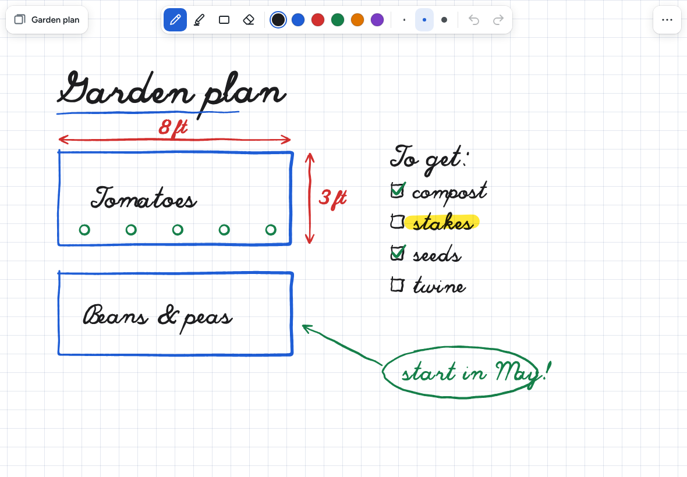
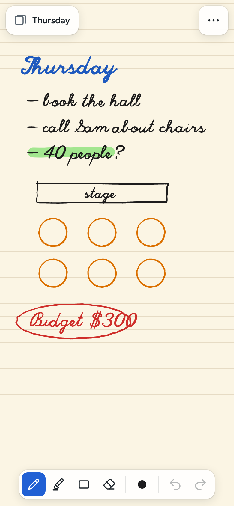
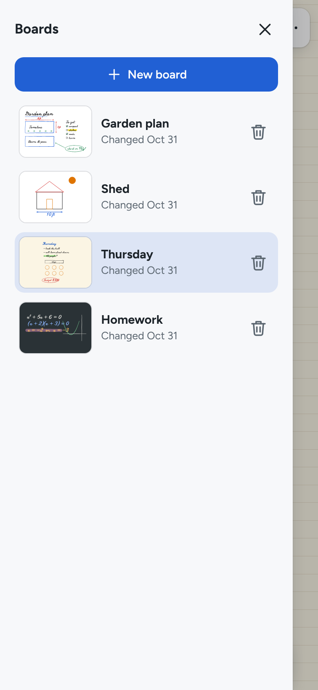
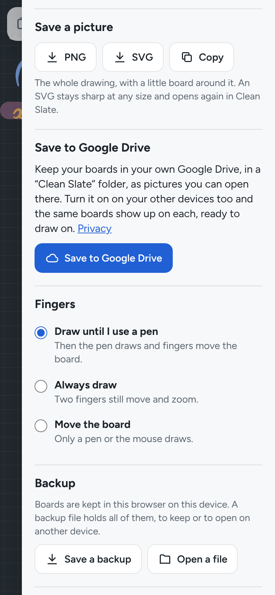

# Clean Slate

**Use it: [clean-slate.junkdrawer.works](https://clean-slate.junkdrawer.works/)**

**A whiteboard for your tablet and pen, in the browser.** Lines get thicker the harder you press. Your palm is
ignored, and two fingers move and zoom the board. Keep as many boards as you like on the device, save any of them
as a picture, or turn on Google Drive and they go into a folder in your own Drive, where you can open them on another
device too. There's no account, no ads and no server.

<p align="center">
  
</p>

<p align="center">
  
  &nbsp;
  
  &nbsp;
  
</p>

## How it works

- **Draw with a pen.** An Apple Pencil, an S Pen, a Surface or Wacom pen: pressure makes the line thicker, and
  Chrome's predicted points keep the ink close behind the tip. A finger or a mouse draws too, a little thicker
  where it moves slowly.
- **Your palm is left alone.** Until a pen has been used, a finger draws. Once one has, the pen draws and a finger
  moves the board. While the pen is down or hovering close, and for a moment after, every touch is taken for a
  resting hand and ignored, and so is any touch much bigger than a fingertip. Under **Fingers** in the menu you can
  also have fingers always draw, or never.
- **Two fingers move and zoom.** Pinch to zoom from 10% to 1000%; the percentage shows in the corner, and tapping it
  goes back to 100%. A quick tap with two fingers is Undo, with three, Redo. **Show it all** in the menu fits the
  whole drawing on screen. With a trackpad, scroll to move and pinch to zoom; with a mouse, the wheel moves it,
  Ctrl + wheel zooms, and Space + drag or the right button moves it.
- **Pen, highlighter, shapes and eraser.** Six ink colours and three sizes, and five highlighter colours that
  multiply into the board so the writing underneath stays black. Each tool remembers its own colour and size. Undo
  and Redo go back up to 300 steps on each board while the page is open, Clear included.
- **Draw a shape and hold still.** Draw a rough line, box, triangle or circle and keep the pen still at the end for
  half a second: it snaps to a clean one, in the same colour and size (a phone that can buzzes once). Keep moving
  and it lets go, so a pause mid-drawing does no harm. A nearly level line is made level, and a nearly round loop
  round. The **shapes tool** drags out exact rectangles, ellipses, lines and arrows, outlined or filled, in the
  pen's colour and size.
- **The eraser rubs out** just where it touches, like a real one: rub the eyes out of a filled-in circle and the
  board shows through. **Whole lines**, beside it in the toolbar (or in its pop-up on a narrow screen), takes away
  every line it touches instead. A pen's eraser end, or its side button held down, erases the same way whatever
  tool is chosen. A rub-out is kept like any other line, so it undoes and syncs the same way.
- **As many boards as you like.** Each one has a name, a colour (White, Paper or Slate) and lines (Grid, Lines,
  Dots or Blank). The colours change with the board, so black ink turns chalk-white on the slate. Each board opens
  where you left it, at the same zoom.
- **Save a picture.** **PNG** saves the whole drawing with a margin of board around it; **SVG** stays sharp at any
  size and opens again in Clean Slate, ready to draw on. On a phone or tablet, **Share** sends the picture to any
  app, and **Copy** puts it on the clipboard where the browser allows it.
- **Google Drive, if you want it.** **Save to Google Drive** in the menu signs in once with Google. Each board then
  goes into a **Clean Slate** folder in your Drive as a picture, `Board name.svg`, which Drive can show like any
  image. It's updated a few seconds after you stop drawing. Turn it on on another device and the same boards show
  up there; draw on both, and both drawings are kept, line by line. A board deleted on one device goes to the Drive
  trash and leaves the others. Google signs the page out after an hour; the cloud button turns red, and one tap
  signs back in. Clean Slate can only see the files it made, never anything else in your Drive. To take the
  permission back, remove junkdrawer.works under **Third-party apps & services** in your Google Account.
- **Kept on your device.** Boards live in this browser's storage on this device, and nothing is sent anywhere
  unless you turn on Google Drive. **Save a backup** puts every board in one file, and **Open a file** brings in a
  backup or a Clean Slate SVG. It works offline, and **Add to Home Screen** makes it a full-screen app with no
  address bar.
- **Keys:** P pen, H highlighter, S shapes, E eraser, 1–6 colours, [ and ] size, F show it all, Ctrl + Z undo,
  Ctrl + Shift + Z or Ctrl + Y redo, Ctrl + 0 back to 100%, Esc closes the menu.

What goes to Google Drive, when it's on: each board's name, background, every line, shape and rub-out (its points,
pressure, colour and size), and the picture of it. The account's email address is read to show where boards are saved. What stays on each
device: which board is open, where each board is scrolled to, the tool, colours and sizes, and the Fingers setting.

## Running it

It's a static site: plain HTML, CSS and JavaScript, with no build step.

```sh
npx serve .                   # or any static file server, then open the printed address
npm test                      # unit tests, then uses it in Chromium through the real page (needs Playwright)
node tools/screenshots.mjs    # redraws docs/*.png and og.png
node tools/make-icons.mjs     # redraws the PNG icons from icon.svg
npm install && npm run build  # dist/clean-slate.html, the whole app in one file
```

To put it online with GitHub Pages: **Settings → Pages → Build and deployment → Deploy from a branch**, then pick
`main` and `/ (root)`. The `CNAME` file serves it at clean-slate.junkdrawer.works.

### Files

- `js/app.js`: the page: the toolbar, the list of boards, the menu, undo, pictures and backups.
- `js/surface.js`: the board on screen, and what the pen, fingers, mouse and trackpad do to it (palms, pinch, the
  two- and three-finger taps, holding still to snap a shape).
- `js/board.js`: a board and its strokes (pen and highlighter lines, shapes and rub-outs), and how two copies of a
  board merge stroke by stroke. No page needed.
- `js/shapes.js`: the shapes tool's shapes, and recognising a hand-drawn line, triangle, rectangle or ellipse. No page
  needed.
- `js/ink.js`: how a stroke looks (its outline, from perfect-freehand), what the eraser touches, and drawing on a
  canvas for the screen, the PNG and the thumbnails. The ink goes on its own layer so a rub-out clears the ink and
  leaves the board's colour and lines.
- `js/svg.js`: a board as an SVG picture with the board tucked inside, for Drive and the SVG download. Rub-outs are
  masks over what was drawn before them.
- `js/store.js`: boards in IndexedDB and settings in localStorage, and changes from the page's other tabs.
- `js/sync.js`: saving to Google Drive (the shared junkdrawer.works sign-in, one file per board, merged per stroke).
- `js/vendor/perfect-freehand.js`: [perfect-freehand](https://github.com/steveruizok/perfect-freehand) 1.2.3 by
  Steve Ruiz (MIT License), which turns a pen's points into a smooth line.
- `fonts/`: Figtree (SIL Open Font License), served from here so nothing loads from elsewhere.
- `sw.js`: keeps a copy for using offline, and opens from it when the connection isn't answering. `FILES` in it is a
  fingerprint of the files it keeps: change one and `npm test` says what to set it to, so a release never leaves the
  copy half old.
- `test/unit.test.mjs`: merging, the SVG file, shapes and the eraser, in Node. `test/e2e.mjs`: a pen with pressure, palms,
  pinches and taps through Chrome's own input, then two devices sharing a stand-in Google Drive
  (`test/fake-google.mjs`), then offline.
- `tools/screenshots.mjs`: draws the sample boards stroke by stroke, with handwriting from the Hershey Script font
  (`tools/hershey-script.json`, from [hersheytext](https://github.com/techninja/hersheytextjs), MIT).
- `scripts/build.mjs`: bundles the app into one HTML file.
